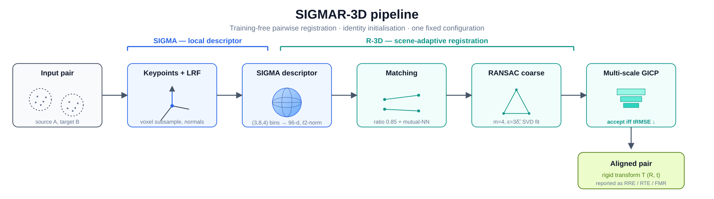
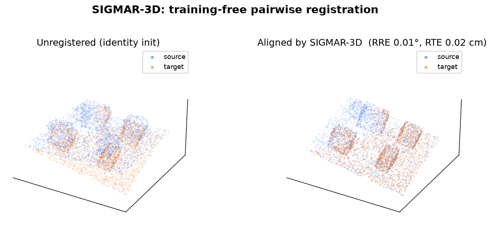

<div align="center">

# SIGMAR-3D

### Scale-Invariant Guaranteed Monotone Accurate Registration for 3D scenes

**Bohdan Vodianyk**<sup>1</sup> &nbsp;·&nbsp; **Enrique Nava-Baro**<sup>1</sup> &nbsp;·&nbsp; **Anton Popov**<sup>2</sup>

<sup>1</sup> Universidad de Málaga, Spain &nbsp;&nbsp; <sup>2</sup> Igor Sikorsky Kyiv Polytechnic Institute / Ukrainian Catholic University

[](LICENSE)


<br/>



</div>

---

**SIGMAR-3D** is a fully **training-free** pipeline for robust pairwise 3D point-cloud
registration. It pairs a handcrafted local descriptor, **SIGMA**, with a scene-adaptive
coarse-to-fine registration stage, **R-3D**, using a *single fixed configuration* across indoor
RGB-D and outdoor LiDAR data — no learning, no training data, no per-dataset tuning, and no
external pose prior (identity initialisation).

> **Why training-free?** Learned descriptors need suitable training data, model selection, and
> maintenance when the sensor or environment changes. SIGMAR-3D keeps three properties that
> matter in deployment: deterministic behaviour, explicit geometric interpretation, and
> cross-domain portability.

This repository is the reference implementation accompanying the paper. The core algorithm in
[`sigmar3d/core.py`](sigmar3d/core.py) is included **verbatim and used unmodified**;
[`sigmar3d/api.py`](sigmar3d/api.py) is a thin wrapper that exposes it as a clean
`register(source, target)` call.

## Highlights

- 🎯 **Training-free & deterministic** — one fixed configuration, identity initialisation.
- 🧭 **SIGMA descriptor** — LRF canonicalisation + spherical binning `(3, 8, 4)` + normal-consistency → compact **96-d** rotation-normalised descriptor.
- 🪜 **Monotone refinement** — multi-scale GICP that accepts an update *only if* the trimmed RMSE decreases.
- 🌐 **Cross-domain** — the same pipeline transfers across indoor RGB-D (3DMatch) and outdoor LiDAR (ETH).
- 📦 **Self-contained** — `pip install -r requirements.txt` and run; a data-free demo recovers a known pose out of the box.

## Results

Reported under a single fixed configuration and identity initialisation (no ground-truth pose or
benchmark metadata used to initialise):

| Benchmark | Modality | FMR | Registration recall |
|---|---|:---:|:---:|
| **3DMatch** | indoor RGB-D fragments | **84.3 %** | **79.0 %** |
| **ETH** | outdoor LiDAR | **72.7 %** | — |

## Demo

No data required — a room-scale scene is synthesised, transformed by a known rigid pose with
partial overlap and noise, and recovered from identity initialisation:

<div align="center">

</div>

```bash
python examples/demo_register.py
python examples/demo_register.py --rotation-deg 35 --overlap 0.5 --noise-mm 3   # harder
```

The figure above is reproducible with `python examples/plot_registration.py` (needs the `viz` extra).

## Method

<table>
<tr><td width="50%" valign="top">

**SIGMA — local descriptor**

At each keypoint a local reference frame (LRF) canonicalises rotation; the spherical support is
partitioned into `(B_r, B_θ, B_φ) = (3, 8, 4)` bins, and each bin accumulates a normal-consistency
term `max(0, n_p · n_q)`. The result is an ℓ2-normalised **96-dimensional** descriptor. Support
radii scale with local point spacing (`r = 8·δ̃`), stabilising it across sensor densities.

</td><td width="50%" valign="top">

**R-3D — registration**

Ratio-test matching (ρ = 0.85) with mutual-NN consistency → RANSAC coarse pose (minimal set
m = 4, inlier threshold ε = 3·δ̃₉, SVD fit) → coarse-to-fine refinement on a voxel pyramid with
robust GICP. An update is accepted **only if** the trimmed RMSE decreases (trim schedule
{0.60, 0.70, 0.80}); very hard pairs use 10-seed multistart.

</td></tr>
</table>

*"Scale-invariant"* is operational: support radii, matching gates, and refinement thresholds are
normalised by scene-scale statistics (point spacing), not fixed metric units (a few absolute
safeguards remain for numerical stability). See the paper's *Materials and Methods* for the full
specification and default-parameter table.

## Installation

Python ≥ 3.9. The one non-trivial dependency is **Open3D**, pinned to `0.19.0` — its registration
backend and point-cloud API vary across releases, and the reported numbers were produced with it.

```bash
conda create -n sigmar3d python=3.11 -y
conda activate sigmar3d
pip install -r requirements.txt
pip install -e .          # optional: makes `import sigmar3d` available everywhere
```

## Quickstart

```python
import numpy as np
from sigmar3d import register

source = np.asarray(...)   # (N, 3) XYZ in metres
target = np.asarray(...)   # (M, 3) XYZ in metres

result = register(source, target)      # identity init, no external prior
print(result.source_to_target)         # (4, 4) transform mapping source -> target
print(result.success, result.trimmed_rmse, result.num_inliers)
```

Loading clouds is left to the caller, e.g. with Open3D:
`pts = np.asarray(o3d.io.read_point_cloud("cloud.ply").points)`.

## API

| Object | Purpose |
|---|---|
| `register(source, target, initial_transform=None, use_coarse=True, enable_multistart=True, seed=2025)` | Register `source` onto `target` (both `(N, 3)` arrays in metres). Returns a `RegistrationResult`. |
| `register_scale_normalized(source, target, target_diag_m=4.0, ...)` | Same, for **small objects** far from the room-scale regime: registers at a normalised scale and unscales the result. Use plain `register` for room/outdoor scenes. |
| `RegistrationResult` | `source_to_target` (4×4), `success`, `num_correspondences`, `num_inliers`, `inlier_ratio`, `trimmed_rmse`, `overlap`, `runtime_s`, `coarse_metrics`, `refined_metrics`, `failure_reason`. |
| `synthesize_scene(n_points=12000, seed=0)` | A deterministic room-scale scene (floor + boxes) as `(N, 3)`. |
| `synthesize_pair(source, rotation_deg=25.0, overlap=0.6, noise_mm=2.0, seed=0)` | Build `(source, target, T_gt)` with a known transform, partial overlap, and noise. |

Convention: `source_to_target` maps source points into the target frame (`target ≈ R·source + t`).

## Reproducing the paper

The benchmarks are large and distributed under their own terms, so they are **not bundled here**:

- **3DMatch** — <https://3dmatch.cs.princeton.edu/> (indoor RGB-D geometric-registration fragments).
- **ETH** — the ETH laser-registration dataset (outdoor LiDAR).

To reproduce a number, load each test pair's two fragments as `(N, 3)` arrays (metres), call
`register(source, target)`, and compare `result.source_to_target` to the provided ground-truth
pose under the benchmark's FMR / RRE / RTE / registration-recall criteria. No scene-specific
tuning is applied; all defaults live in [`sigmar3d/core.py`](sigmar3d/core.py).

## Tests

```bash
pip install -e ".[dev]"
pytest
```

The smoke tests synthesise a pair with a known pose and assert SIGMAR-3D recovers it
(rotation error < 5°, translation error < 10 cm) — a quick end-to-end check of the install.

## Citation

If you use this software, please cite the paper (metadata in [`CITATION.cff`](CITATION.cff)):

```bibtex
@article{vodianyk2026sigmar3d,
  title   = {SIGMAR-3D: Scale-Invariant Guaranteed Monotone Accurate Registration for 3D scenes},
  author  = {Vodianyk, Bohdan and Nava-Baro, Enrique and Popov, Anton},
  year    = {2026},
  note    = {Under review}
}
```

## License

Released under the [MIT License](LICENSE). © 2026 Bohdan Vodianyk.
